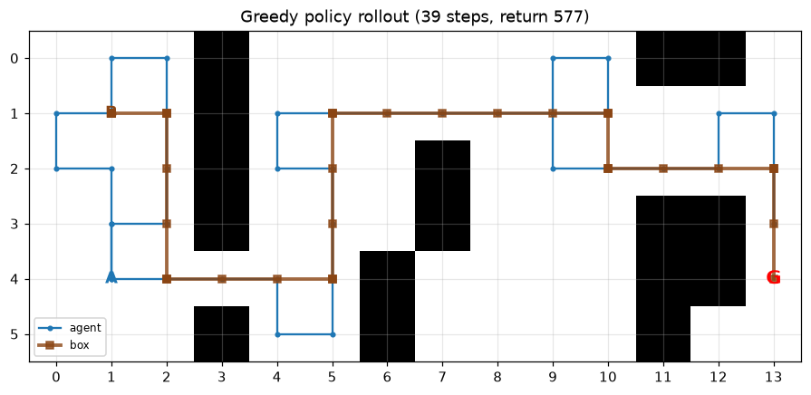
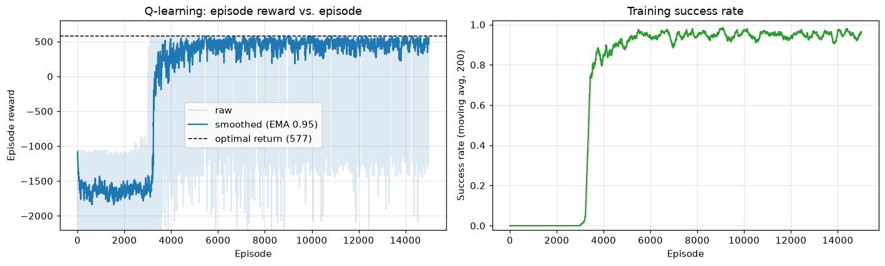
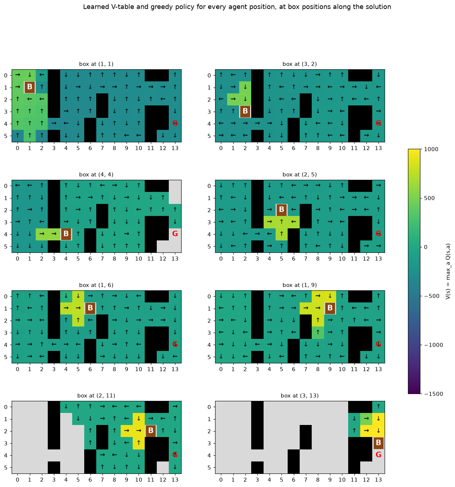
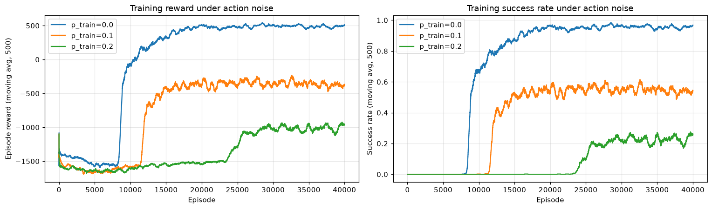
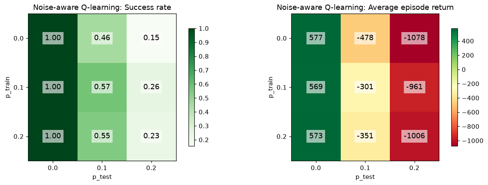
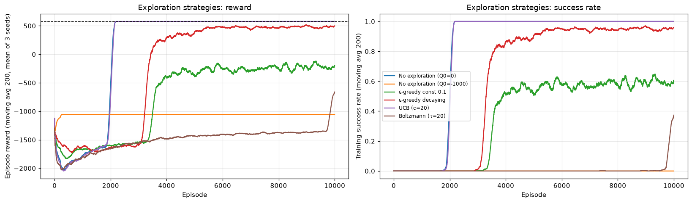

# Q-Learning for Cliff Box Pushing (Reinforcement Learning)

A tabular **Q-learning** agent that learns to push a box to a goal in a 6×14 grid world full of cliffs. The project also includes a **noise-aware Q-learning** extension for robustness to random action noise, a comparison of **exploration strategies**, and a solution to a **sparse-reward** version of the task.

> Individual assignment for **AI6101 Introduction to AI and AI Ethics** (MSc Artificial Intelligence, NTU Singapore, AY2026/27 Semester 1).



## Highlights

- **Optimal solution:** the learned greedy policy solves the puzzle in **39 steps (return 577)**, matching the value-iteration optimum, with **100% success** over 1,000 test runs.
- **2.3× faster learning** than the template defaults, thanks to decaying ε-greedy, α = 0.5 and correct handling of timeouts. Training success rose from 58% to 95%.
- **Noise-aware Q-learning (my extension):** under action noise, the agent reaches **0.57 / 0.23** success at p = 0.1 / 0.2, close to the theoretical optimum of 0.58 / 0.25. Vanilla Q-learning only gets 0.40 / 0.00.
- **Sparse reward solved:** with reward only at the goal, optimistic initialisation (Q₀ = 1000) solves the task. ε-greedy and count-based bonuses never do.

## The problem

| | |
|---|---|
| **State** | Agent position + box position (7,056 states) |
| **Actions** | Up, down, left, right |
| **Reward** | −1 per step, minus the agent–box and box–goal distances; −1000 for falling off a cliff; +1000 when the box reaches the goal |
| **Episode ends** | Cliff, goal reached, or 100 steps |

The hard part is that the only route to the goal runs right beside the cliffs, so random exploratory moves often end the episode.

## Approach

**Q-learning update**

$$Q(s,a) \leftarrow Q(s,a) + \alpha\big[r + \gamma \max_{a'} Q(s',a') - Q(s,a)\big], \quad \gamma = 0.99$$

Design choices:

- **Decaying ε (0.2 → 0.01):** explore early, then stop random moves from pushing the box off a cliff.
- **α = 0.5:** the dynamics are deterministic, so large steps are safe and values spread faster.
- **Q₀ = 0 is optimistic:** every step reward is negative, so untried actions look attractive, which gives systematic exploration.
- **Timeouts are bootstrapped, not terminal:** time is not part of the state, so treating the 100-step cut-off as terminal would bias values.

**Noise-aware Q-learning.** With probability *p*, the chosen action is replaced by a random other action. Because the noise model is known, the agent learns Q for the action that was *actually executed* and acts on the expected value:

$$Q_p(s,a) = (1-p)\,Q_{det}(s,a) + \frac{p}{3}\sum_{b \neq a} Q_{det}(s,b)$$

This has the same fixed point as Q-learning on the noisy MDP, but with a lower-variance learning target.

## Results

### Learning curve


### Learned value function and policy
The value V(s) = maxₐ Q(s,a) (colour) and greedy action (arrows) for every agent cell, with the box fixed at positions along the solution path.



### Robustness to action noise
Agents trained with p_train ∈ {0, 0.1, 0.2} and tested with p_test ∈ {0, 0.1, 0.2}, 500 episodes per cell.




- Training with moderate noise (p = 0.1) **improves robustness** (success at p_test = 0.1 goes from 0.46 to 0.57) with no loss in the noise-free setting.
- The noisy agent learns a **safer route**, keeping one extra cell away from the cliffs.

### Exploration strategies (bonus)

| Strategy | First success (episode) | Training success |
|---|---|---|
| Greedy, Q₀ = 0 (optimistic) | **1742** | 1.00 |
| UCB (c = 20) | 1755 | 1.00 |
| ε-greedy, decaying | 2923 | 0.95 |
| ε-greedy, constant 0.1 | 3052 | 0.60 |
| Boltzmann (τ = 20) | 8436 | 0.10 |
| Greedy, Q₀ = −1000 (pessimistic) | never | 0.00 |



### Sparse reward (bonus)

| Method | First success | Greedy success |
|---|---|---|
| ε-greedy, Q₀ = 0 | never | 0.00 |
| + state-count bonus | never | 0.00 |
| **Optimistic Q₀ = 1000 + greedy** | **≈ 3.1k** | **1.00** |

## Repository structure

```
├── cliffbox_qlearning.ipynb   # Full code: environment, agent, experiments, plots
├── report.pdf                 # 2-page report
├── *.png                      # Figures used in this README
└── requirements.txt
```

## How to run

```bash
pip install -r requirements.txt
jupyter notebook cliffbox_qlearning.ipynb
```

Then run all cells. The main agent trains in about a minute on a laptop CPU. The full notebook (robustness study and bonus experiments) takes longer. You can also open the notebook in [Google Colab](https://colab.research.google.com/).

## Tech stack

Python · NumPy · Matplotlib · Jupyter

## Acknowledgements

The `CliffBoxGridWorld` environment and the notebook template were provided by the AI6101 course teaching team at NTU. The agent, experiments, extensions and analysis are my own work.
